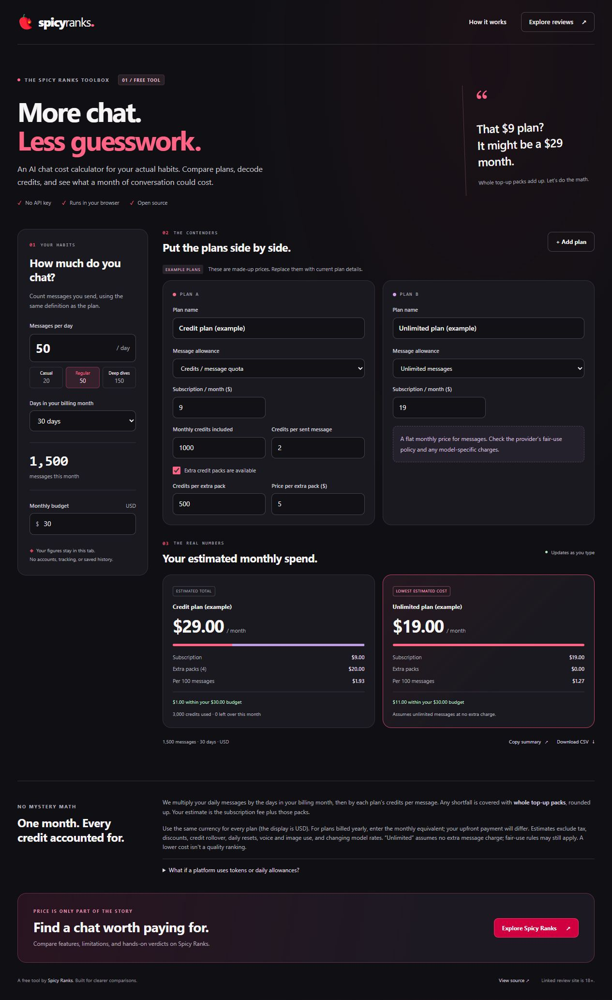

# Spicy Chat Cost Calculator

**What will your AI companion chat plan actually cost this month?**

[**Use the free calculator →**](https://jack-srai.github.io/spicy-chat-cost-calculator/)

A free, open-source tool by [Spicy Ranks](https://spicyranks.ai/) for comparing AI chat subscriptions, message credits, and top-up packs at your expected usage. Enter your own prices, compare up to four plans, and export the results. Everything runs in your browser. No account, API key, installation, or backend required.



## What it does

- Estimates monthly spend from messages per day, billing-month length, and fixed credits per sent message.
- Compares metered and unlimited-message plans with a monthly budget.
- Rounds extra credits up to **whole top-up packs** instead of pretending you can buy fractions of a pack.
- Flags plans whose quota cannot cover your usage when extra packs are unavailable.
- Shows subscription cost, top-up cost, unused credits, and effective cost per 100 messages.
- Copies a plain-text comparison or downloads a CSV with both inputs and results.
- Works on mobile, supports keyboard navigation, and makes no third-party network requests.

The example plans are fictional. **Replace their prices and limits with current provider information.** No provider integrations or live price feeds are included.

## Run it

Download or clone this repository and open **index.html** in your browser. All assets are local; no build step or package installation is needed. If clipboard access is unavailable, the tool offers a selectable-text fallback.

For a local web-server preview, with Node.js 20 or newer:

```sh
git clone https://github.com/jack-srai/spicy-chat-cost-calculator.git
cd spicy-chat-cost-calculator
npm start
```

Open **http://127.0.0.1:4177**. Alternatively, use `python -m http.server 8000 --bind 127.0.0.1` from the project folder.

## How the estimate works

```text
monthly messages = messages per day × days in billing month
credits needed   = monthly messages × credits per sent message
credit shortfall = max(0, credits needed − included monthly credits)
packs needed     = ceil(credit shortfall / credits per extra pack)
estimated cost   = monthly subscription + packs needed × price per pack
```

For the fictional $9 credit plan, 50 messages/day over 30 days at 2 credits/message needs 3,000 credits. With 1,000 included credits and 500-credit packs at $5, that means four extra packs: **$9 + (4 × $5) = $29**.

A plan with unlimited messages is modeled as a flat subscription. If a metered plan is short on credits and cannot buy more, it is excluded from the lowest-cost result. All plans tied for lowest cost receive the same label. Zero-message usage still incurs the subscription charge; cost per 100 messages is then undefined.

### Assumptions and limits

- All prices use the same currency, displayed as USD. The tool does not convert currencies.
- It models one billing month with a fixed credit cost per sent message. For annual plans, enter the monthly equivalent; this does not show the upfront charge.
- Taxes, discounts, credit rollover, daily resets/expiry, images, voice, variable context costs, and token-based LLM billing are not modeled.
- A token is not the same as a message credit. Variable token billing cannot be converted precisely without usage assumptions.
- Check unlimited plans for fair-use limits and extra model fees. "Lowest cost" is a calculation from your inputs, not an assessment of quality.
- This is an estimate, not a quote from a provider.

## Privacy

The tool does not call external APIs, load third-party fonts, use analytics, or store plan inputs in cookies or local storage. Your entries remain in the current tab and reset when you reload. Copying or downloading exports data only when you choose that action. Visiting an external link contacts that destination; a static host may also keep its normal access logs.

## Development and tests

Uses plain HTML, CSS, JavaScript, and Node's built-in test runner. No runtime or development dependencies.

```sh
npm test
```

Tests cover pack rounding, quota shortfalls, unlimited/free plans, decimal precision, zero usage, invalid input, and CSV formula escaping. The calculation module is shared between the browser and tests.

| File                        | Purpose                                            |
| --------------------------- | -------------------------------------------------- |
| `index.html` / `styles.css` | Responsive branded interface                       |
| `calculator.js`             | Pure calculation and CSV escaping functions        |
| `app.js`                    | Form interactions, comparison results, and exports |
| `tests/calculator.test.js`  | Calculation regression tests                       |
| `serve.js`                  | Optional localhost-only preview server             |

Any static host can serve the application files and `pepper.png`. For GitHub Pages, choose **Settings → Pages → Deploy from a branch → main → / (root)**. This publishes the tool, not the main Spicy Ranks application.

## About Spicy Ranks

[Spicy Ranks](https://spicyranks.ai/) publishes hands-on reviews and comparisons of adult AI chat, image, voice, and video platforms, including pricing and free-tier limits. The review site is **18+** and may earn affiliate commissions. This calculator contains no adult imagery, provider affiliate links, or paid placements.

Use the calculator for the numbers, then read the reviews for the features and tradeoffs.

## Questions and ideas

Use [Discussions](https://github.com/jack-srai/spicy-chat-cost-calculator/discussions) for questions, feature ideas, or feedback. For reproducible bugs, open an issue with sample plan inputs and the result you expected. Please do not include account credentials or private conversations.

## License

[MIT](LICENSE). The Spicy Ranks name and logo identify the publisher; the license does not grant an endorsement or trademark rights. This tool is an original implementation; the reference project's code and copy were not reused.
